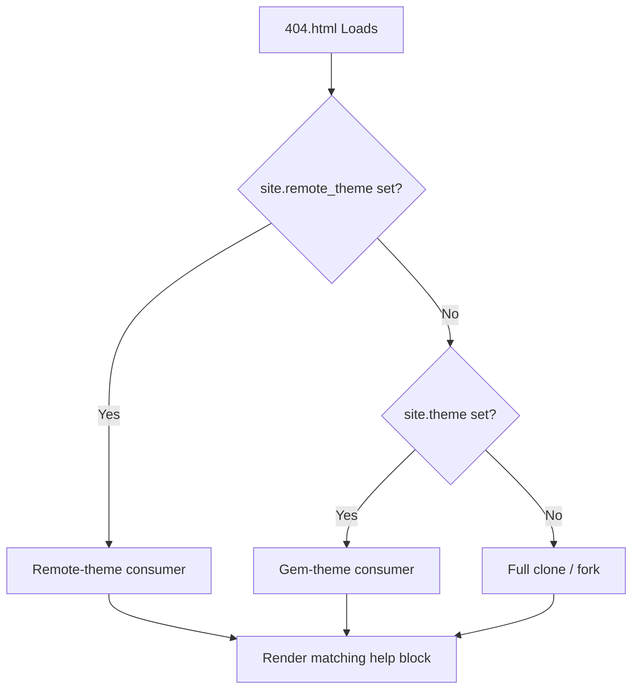

---
aliases:
- /docs/features/smart-404/
categories:
- docs
- features
description: How the zer0-mistakes 404 page auto-detects whether the site is a fork,
  remote-theme consumer, or full clone and guides visitors back to a working entry
  point.
difficulty: beginner
estimated_reading_time: 5 minutes
lastmod: 2026-06-15 00:00:00+00:00
layout: default
mermaid: true
permalink: /docs/features/smart-404/
preview: /images/previews/smart-404-site-configuration-detection.png
sidebar:
  nav: docs
source_file: sites/zer0-pages/pages/_docs/features/smart-404.md
source_repo: bamr87/zer0-CMS
source_url: https://github.com/bamr87/zer0-CMS/blob/main/sites/zer0-pages/pages/_docs/features/smart-404.md
tags:
- setup
- '404'
- configuration
- ux
title: Smart 404 & Site Configuration Detection
type: doc
---

# Smart 404 & Site Configuration Detection

The zer0-mistakes `404.html` is not a plain "page not found" placeholder. It detects how the site is deployed and offers context-aware guidance to the visitor.


## Detection Logic



The Liquid template inspects `site.remote_theme`, `site.theme`, and a small set of `site.github.*` variables that GitHub Pages injects at build time.

## Implementation

The smart 404 lives in the repository root:

```text
404.html
```

Key Liquid variables used:

| Variable | Purpose |
|---|---|
| `site.remote_theme` | Detect remote-theme mode |
| `site.theme` | Detect gem-theme mode |
| `site.github.owner_name` | Link back to the correct GitHub profile |
| `site.url` / `site.baseurl` | Build absolute links to the home page |

## What Visitors See

### Remote-theme consumer

```text
🔍 Page Not Found
This page doesn't exist on this site.
→ Return to home  → View the theme source on GitHub
```

### Full clone / fork

```text
🔍 Page Not Found
It looks like this page was removed or the URL changed.
→ Return to home  → Browse the docs
```

## Customizing the 404

Override just this file in your site repo:

```text
your-site/
└── 404.html   ← Your custom version takes precedence
```

The theme's `404.html` is only used when no local override exists.

## Related

- [[zer0-CMS/sites/zer0-pages/pages/_docs/getting-started/quick-start|Quick Start Guide]]
- [[zer0-CMS/sites/zer0-pages/pages/_docs/quickstart/bare-minimum|Bare-Minimum Starter]]

## See also

- [[zer0-CMS/sites/zer0-pages/pages/wiki/sources/_index|Features]]
- [[zer0-CMS/sites/zer0-pages/pages/wiki/sources/_index|Getting Started]]
